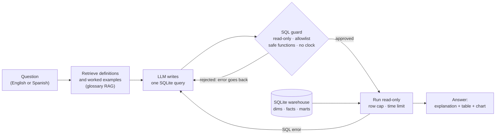
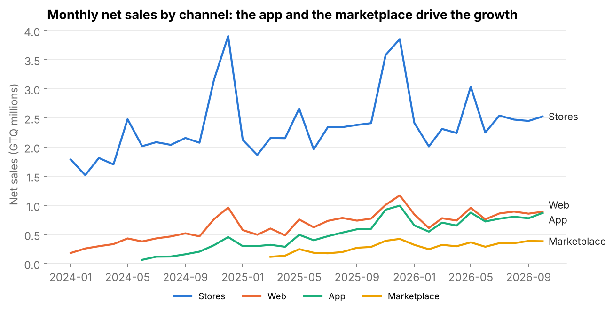
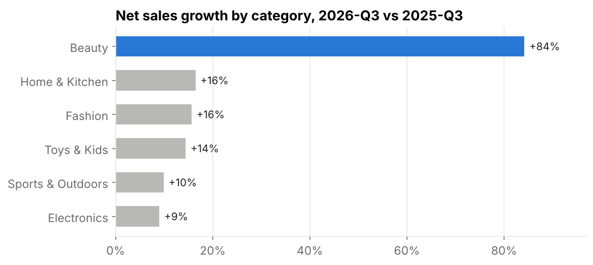
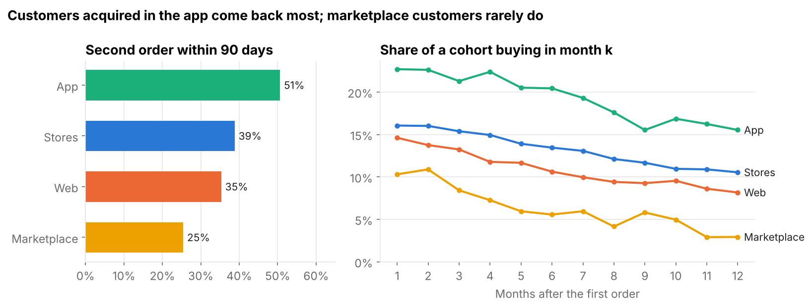
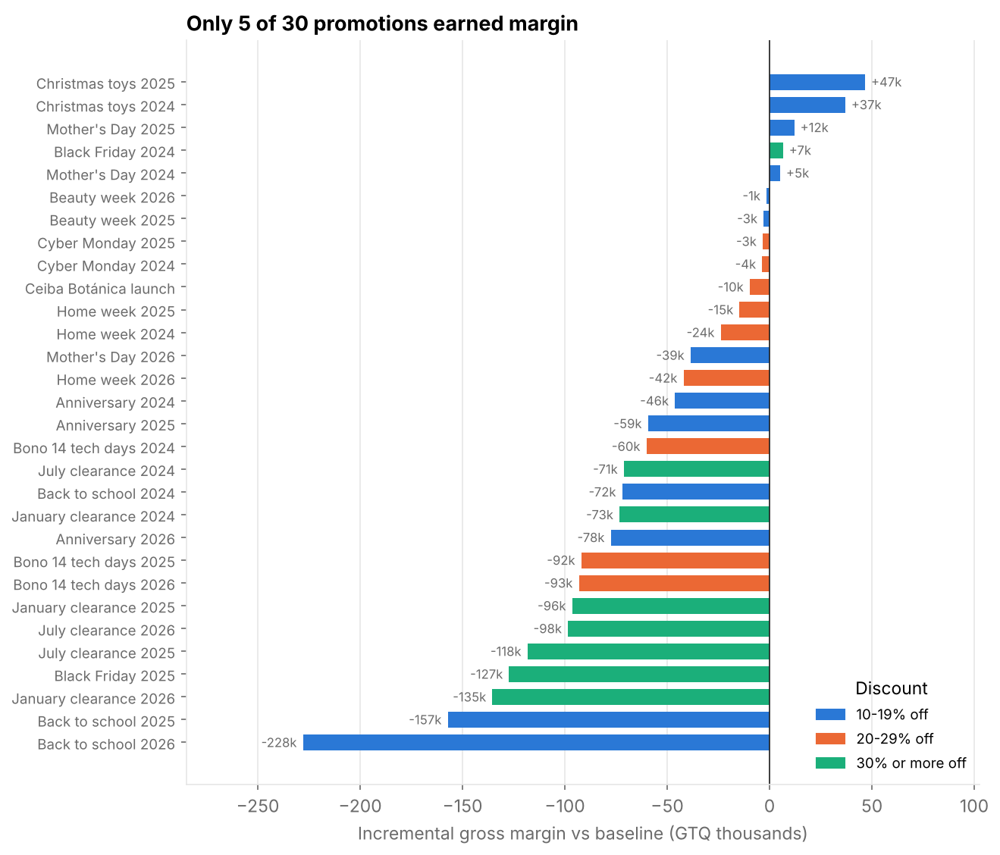

# AI Data Assistant: Ask a Retail Data Warehouse in Plain English or Spanish

A retail / e-commerce case study with an **LLM assistant on top of a SQL data warehouse**. A business user asks
*"¿Qué categoría creció más el último trimestre?"* or *"What is the repurchase rate by channel?"*; the assistant
looks up the company's metric definitions (RAG), writes a SQLite query, a **guard validates it** (read-only,
approved tables only, row and time limits) before it runs, and the answer comes back as a short explanation,
a table and a chart. A **25-question evaluation set** with known answers measures how often it is right.

Underneath is the same kind of pipeline as my other projects: four messy source systems (POS, e-commerce,
CRM, catalog) cleaned by a layered SQL warehouse with quality checks, plus a business analysis of channels,
categories, retention and promotions.

**Stack:** Python (pandas) · SQL (SQLite: CTEs, window functions, recursive CTE) · Claude API (or OpenAI) ·
retrieval over a business glossary (BM25) · Streamlit · matplotlib · pytest · GitHub Actions



---

## The business problem

**Casa Ceiba** (fictional) is an omnichannel retailer in Guatemala: electronics, home, fashion, beauty, sports
and toys, sold through seven stores, a website, a mobile app (launched June 2024) and a third-party
marketplace (March 2025, 15% commission). Managers keep sending the analytics team the same kind of questions:
*how did the quarter go, which channel brings loyal customers, did Black Friday pay off?* The goal:

1. **Self-service answers**: let managers ask in their own words, in English or Spanish, and get a correct number.
2. **The company's definitions, not generic ones**: "net sales" excludes returns, "repurchase" means a second
   order within 90 days, "last quarter" is measured from the data's reference date.
3. **Safe by construction**: the assistant can never change data or read tables it should not (e-mails live in staging).
4. **Measured, not assumed**: a fixed evaluation set says how often the assistant is right.
5. **The analysis itself**: where is growth coming from, which customers stay, which promotions pay?

## How the assistant works

| Step | What happens | Code |
|---|---|---|
| **Retrieve** | BM25 over the business glossary (25 definitions with English and Spanish aliases) and 16 worked examples picks what is relevant to the question. Two entries (reference date, SQL conventions) go into every prompt | `src/assistant/retriever.py`, `knowledge/glossary.yaml` |
| **Generate** | The LLM gets the documented schema (17 tables, every column described), the retrieved definitions and examples, and returns JSON: the SQL, a chart suggestion and the assumption it made | `src/assistant/prompts.py`, `knowledge/schema.yaml` |
| **Validate** | The SQL guard checks the query before anything runs (below). A rejected query goes back to the LLM with the reason, up to 2 repairs | `src/assistant/sql_guard.py`, `src/assistant/core.py` |
| **Run** | Read-only connection, 10-second limit, at most 500 rows returned | `src/assistant/sql_guard.py` |
| **Explain** | A second LLM call turns the result into 2-4 sentences in the language of the question; a chart is chosen from the LLM's hint or a heuristic | `src/assistant/core.py`, `src/assistant/charts.py` |

### Safety: what the guard enforces

Nothing the LLM writes runs without passing all of these. They do not rely on the prompt being obeyed.

| Layer | What it blocks | How |
|---|---|---|
| Static checks | More than one statement, anything that is not `SELECT` / `WITH`, `INSERT` `UPDATE` `DELETE` `DROP` `ALTER` `CREATE` `ATTACH` `PRAGMA`..., and `'now'` / `CURRENT_DATE` | Keyword scan with string literals and comments masked out (so `'DROP TABLE'` inside a string is fine, and a `;` hidden after a comment is not) |
| Table allowlist | Reading `raw_*`, `stg_*` (where customer e-mails are), `sqlite_master`, anything not documented for the assistant | SQLite compiles the query with an **authorizer callback** that sees every table SQLite resolves, through subqueries, CTEs and quoted names. Columns joined with `USING` are not reported to the authorizer, so the **compiled program is checked too**: every table and index it opens must belong to an allowed table |
| Function allowlist | `load_extension()`, `randomblob()` and any function not on a list of ~60 aggregate, window, text and date functions | Same authorizer |
| Read-only execution | Any write, even if every check above failed | `mode=ro` connection plus `PRAGMA query_only` |
| Resource limits | Runaway queries (e.g. an infinite recursive CTE) and huge results | Progress handler stops the query after 10 s; rows fetched are capped at 500 |

The guard has its own test file with 30+ allowed and malicious queries ([`tests/test_sql_guard.py`](tests/test_sql_guard.py)).

### Business definitions (the glossary)

Generic text-to-SQL gets these wrong; the glossary is how the assistant gets them right. A few of the 25 entries:

| Term | Casa Ceiba's definition |
|---|---|
| Net sales | Gross sales - promotional discounts - refunds, completed orders only. Returns count against the original order date |
| Gross margin % | Sum of gross margin / sum of net sales (a ratio of sums, never an average of percentages) |
| Contribution margin | Gross margin - marketplace commission (15% of marketplace net sales) |
| Repurchase rate | Share of new customers who order again within 90 days of their first order, counting only customers whose 90-day window has closed. "By channel" = by acquisition channel |
| Active customer | At least one completed order in the 365 days up to the reference date |
| Growth | Year over year unless the user says otherwise (sales are seasonal). "Last quarter" = 2026-Q3 |
| Reference date | 2026-10-31. "This year", "last month" and "last 12 months" are measured from it, never from the clock |

Each entry has Spanish aliases (*tasa de recompra, ventas netas, ticket promedio, cliente activo...*), so a
question in Spanish retrieves the same definitions. The retriever is a 60-line BM25 rather than a vector store:
with 41 short documents, keyword search with bilingual aliases is deterministic, testable offline and needs no
embedding API. It sits behind a small `Retriever` interface, so LangChain + embeddings could replace it
without touching anything else.

## Evaluation

[`eval/questions.yaml`](eval/questions.yaml) has **25 business questions** (5 in Spanish) about sales, margin,
channels, customers, retention, promotions and stores, each with a **gold SQL query** whose result is the
correct answer. [`scripts/run_eval.py`](scripts/run_eval.py) asks the assistant every question, runs its SQL and
compares results, not SQL text, so any correct query counts: other joins, a mart instead of the fact table,
other column names or order, a fraction instead of a percentage. Questions are scored three ways: same rows
(`set`), right top answer (`first_row`, for "which... most?") or headline numbers present (`values`).
Details per question: [**docs/eval_results.md**](docs/eval_results.md).

<!-- EVAL:START -->
| Model | Correct | Execution accuracy | Run on |
|---|---|---|---|
| Offline baseline: no LLM, reuses the closest worked example | 0 / 25 | **0%** | 2026-11-23 |
<!-- EVAL:END -->

The offline baseline answers every question with the SQL of the closest worked example and scores 0%. That is
by design: the worked examples cover different questions from the evaluation set, so copying them never
works, and the score measures real SQL generation. The scorer itself is tested: a model that writes the gold
SQL scores 100%, and correct alternatives (fractions, extra columns, month names) pass while wrong ones fail.

To evaluate a real model, run `python scripts/run_eval.py --provider anthropic` with `ANTHROPIC_API_KEY` set,
or run the **Evaluate with an LLM** workflow in GitHub Actions (it uses the repository secret). Either way the
results file and the table above are regenerated.

## The app

```bash
streamlit run app/streamlit_app.py
```

- **Ask the data**: a chat. Every answer shows the explanation, the table and a chart, and *How this was
  answered* opens the SQL, the assumption, the tables read, the definitions used and any rejected attempts.
  Follow-up questions ("and by channel?") carry the conversation.
- **Business overview**: year-to-date KPIs vs last year, net sales by channel, category growth, repurchase
  by channel and the promotion scorecard.

The API key comes from `ANTHROPIC_API_KEY` (or `OPENAI_API_KEY`), as an environment variable or in Streamlit
secrets; it is never stored in the repository. **Without a key the app runs in demo mode**: it shows the whole
pipeline (retrieval, guard, execution, chart) with the closest worked example instead of an LLM, and suggests
questions it can answer. If the warehouse does not exist, the app builds it on first start (about a minute).

**Deploy on Streamlit Community Cloud:** *New app* -> this repository, branch `main`, file
`app/streamlit_app.py` -> *Advanced settings* -> Secrets: `ANTHROPIC_API_KEY = "sk-ant-..."` -> Deploy.

## Key findings

*Default run: 154,888 orders and 229,927 order lines, January 2024 - October 2026. Full queries and results:
[**docs/business_analysis.md**](docs/business_analysis.md).*

| KPI | 2026 YTD (Jan-Oct) | Same period 2025 | Change |
|---|---|---|---|
| **Net sales** | **Q43.2M** | Q35.0M | **+23.7%** |
| Orders | 55,029 | 42,297 | +30.1% |
| Average order value | Q786 | Q827 | -4.9% |
| Gross margin | 36.1% | 35.1% | +1.0 pts |
| New customers | 9,596 | 8,010 | +19.8% |

**Growth comes from the app and the marketplace**
- Stores still make **56% of sales but grew only 8%**. The app grew **71%** and the marketplace **104%**;
  together they delivered **58% of the year's growth**.
- Growth is in orders, not basket size: average order value fell 5% as more small online orders came in.



**Beauty grew most last quarter, thanks to a private label**
- Beauty net sales rose **84%** in 2026-Q3 vs 2025-Q3; every other category grew 9-17%.
- The **Ceiba Botánica** skincare line (launched March 2026) is already **30% of Beauty sales**, and the other
  Beauty brands still grew 29%: the new line added sales instead of cannibalizing them, at a 62% margin.
- Electronics is the biggest category but earns a **16% gross margin**, a quarter of Beauty's.



**App customers are the most valuable; marketplace customers are expensive**
- **51%** of customers acquired in the app order again within 90 days, against 39% in stores, 35% on the web
  and **25% on the marketplace**. A year later 15.5% of app customers still buy each month vs 2.8% of
  marketplace customers.
- After returns (9.2% vs 3.4% in stores) and the 15% commission, the marketplace keeps a **14% contribution
  margin**, against 39% in the app.
- **Recommendation:** use the marketplace for reach, but invest in moving its buyers to the app (first-order
  incentive in the app, app-only offers); in stores, only 26-46% of tickets carry a loyalty card, so most store
  shoppers cannot be retargeted at all.



**Most promotions bought sales at the expense of margin**
- Of 30 promotions, **only 5 earned more gross margin than the baseline**: the 15% Christmas toys and Mother's
  Day campaigns, and Black Friday 2024. Across all of them, promotions cost about **Q1.64M of gross margin**
  against the baseline.
- Lift is measured with **difference-in-differences**: promoted categories against categories not on
  promotion over the same days, so seasonality (December to January, Mother's Day traffic) is not credited
  to the discount.
- **Deep discounts (30% or more) pull demand forward**: units +152%, margin from 53% to 24%, and sales of the
  same categories run **25% below baseline for three weeks afterwards**.
- **Black Friday 2025 went to 35% off (from 30%)**: net sales rose 19%, but gross margin fell from 10.9% to
  3.0% (electronics sold at -24%), turning a break-even event into a Q131k loss.
- Percentage discounts on electronics never pay: *Bono 14 tech days* (20% off) sells at cost, and
  *back to school* loses the most because it discounts electronics.
- **Recommendation:** keep event-driven 15% promotions, go back to 30% on Black Friday, and replace percentage
  discounts on electronics with bundles or financing.



## The data pipeline

| Step | What happens | Code |
|---|---|---|
| **Extract** | Simulates the four source systems with their usual problems | `src/generate_data.py` |
| **Load** | Saves the raw files and loads them as `raw_*` / `ref_*` tables | `src/load.py` |
| **Transform** | Four SQL layers: staging (cleaning), dimensions, facts and 6 marts | `sql/01_staging.sql` ... `sql/04_marts.sql` |
| **Quality** | 15 checks (every order loaded, cancelled or rejected; no test orders; duplicate customers merged; returns never exceed sales; sales reconcile across layers...); any failure stops the run | `src/quality.py` |
| **Export** | Every `mart_*` table to CSV for Tableau / Looker Studio | `src/export.py` |

### The raw data is messy on purpose

| Problem in the raw extract | Rows affected | Fix in `01_staging.sql` |
|---|---|---|
| E-commerce timestamps in UTC (Guatemala is UTC-6) | 25,652 orders change date | Converted to local time before taking the date |
| POS dates as `dd/mm/yyyy hh:mm` and amounts as text (`"Q1,234.50"`) | all 157,492 POS lines | Parsed and cast |
| Store returns as negative-quantity lines pointing at the original ticket | 5,450 lines | Moved to returns and matched to the sale |
| Duplicate CRM accounts (same e-mail with spaces or capitals) | 794 accounts | Merged into the earliest account; orders follow |
| QA test accounts ordering in production | 60 orders | Rejected with a reason |
| Orders re-sent by the integration (first copy still `pending`) | 793 orders | Latest copy kept (`ROW_NUMBER`) |
| Cancelled orders | 2,053 orders | Kept apart in `stg_cancelled_orders` |
| Device clock errors (orders dated 2039-2098) | 22 orders | Rejected |
| Channel typed by hand (`web`, `Online`, `App Móvil`, `MKT`...) | 16,308 orders | Mapped through `ref_channel_aliases` |
| SKUs in lower case or with spaces | 6,255 lines | `UPPER(TRIM())` |
| Returns that match no sale | 20 returns | `stg_rejected_returns` (check: < 1%) |
| Department spelled several ways (`Guate`, `Xela`, `Peten`...) and two signup date formats | 6,484 and 8,251 customers | Alias table; both formats parsed |
| Catalog categories in Spanish or capitals (`Belleza`, `ELECTRÓNICA`) | 74 products | Mapped through `ref_category_map` |
| Missing unit cost | 6 products | Imputed from the subcategory's cost ratio, flagged `cost_imputed` |

### The data model

| Layer | Tables |
|---|---|
| Dimensions | `dim_date`, `dim_customer` (with first order, acquisition channel, cohort, 90-day repeat flag, active flag), `dim_product`, `dim_channel`, `dim_store`, `dim_promotion`, `dim_promotion_scope` |
| Facts | `fct_order_lines` (the grain of every sales metric), `fct_orders`, `fct_returns` |
| Marts | `mart_sales_monthly`, `mart_category_quarterly`, `mart_customer_cohorts`, `mart_repurchase`, `mart_promo_performance`, `mart_kpi_summary` |

All of them, plus `ref_parameters` (the reference date and business rules), are documented column by column in
[`knowledge/schema.yaml`](knowledge/schema.yaml), the same file the assistant reads.

### The data

The data is **synthetic** (no real retailer), but generated with realistic mechanics so both the analysis and
the assistant have real signal: Black Friday, Christmas, Mother's Day, back to school, Bono 14 and paydays;
customers with personal purchase rates and churn risk that depend on how they were acquired; channel launches;
a private-label launch; returns by category and channel; and promotions that lift sales, pull demand forward
and can sell below cost. See [`src/generate_data.py`](src/generate_data.py).

## How to run it

Requires Python 3.10+ (developed on Python 3.14, macOS).

```bash
git clone https://github.com/pabloanalyst1/ai-data-assistant.git
cd ai-data-assistant
python3 -m venv .venv && source .venv/bin/activate     # Windows: .venv\Scripts\activate
pip install -r requirements.txt

python run_pipeline.py                 # builds data/warehouse.db and exports/*.csv (~40 seconds)
python -m pytest                       # 140+ tests, no API key needed
streamlit run app/streamlit_app.py     # the app (demo mode without a key)

# With an API key (never commit it):
export ANTHROPIC_API_KEY="sk-ant-..."  # or put it in .streamlit/secrets.toml (see the .example file)
streamlit run app/streamlit_app.py     # real answers
python scripts/run_eval.py             # 25-question evaluation, updates the table above

python scripts/run_case_study.py       # refreshes docs/business_analysis.md
python scripts/make_readme_charts.py   # refreshes the README charts
```

The simulated data is identical on every machine (Apple Silicon, Intel, Linux): the generator draws only
uniform random numbers and rounds every transformed value, and a test pins a fingerprint of the default extract.
With the default seed you get exactly the numbers in this README. `LLM_PROVIDER` (`anthropic`, `openai`, `mock`)
and `LLM_MODEL` override the defaults (Claude Sonnet 5.5 if its key is set, otherwise OpenAI, otherwise demo mode).

## Project structure

```
├── run_pipeline.py                # orchestrates the 5 pipeline steps
├── app/streamlit_app.py           # chat + business overview
├── src/
│   ├── config.py                  # period, reference date, channels, guardrail limits, paths
│   ├── generate_data.py           # synthetic POS, e-commerce, CRM and catalog extracts (and their problems)
│   ├── load.py · transform.py · quality.py · export.py
│   ├── evaluation.py              # execution-accuracy scorer
│   └── assistant/
│       ├── core.py                # question -> retrieve -> generate -> guard -> run -> explain (with repair)
│       ├── sql_guard.py           # static checks, authorizer, compiled-program check, read-only execution
│       ├── retriever.py           # BM25 over the glossary and worked examples
│       ├── llm.py                 # Claude, OpenAI and offline providers
│       ├── prompts.py · charts.py · knowledge.py
├── knowledge/                     # schema.yaml, glossary.yaml, examples.yaml (what the assistant knows)
├── eval/questions.yaml            # 25 questions with gold SQL
├── sql/
│   ├── 01_staging.sql … 04_marts.sql
│   └── analysis/                  # 10 business questions (q01 … q10)
├── tests/                         # guard, assistant loop, scorer, hand-made SQL cases, pipeline, app
├── scripts/                       # evaluation, business analysis and chart generators
├── exports/                       # dashboard-ready CSV files
├── docs/                          # business analysis, evaluation results, charts
└── .github/workflows/             # CI (tests on 3.12 and 3.14, offline) and the manual LLM evaluation
```

## Design decisions

- **The guard does not trust the prompt.** The prompt asks for read-only SQL, but safety comes from SQLite
  itself: its compiler resolves the tables (authorizer + compiled program), the connection is read-only, and
  limits are enforced at run time. A prompt injection can change what the LLM writes, not what runs.
- **Definitions live in data, not in the prompt text.** The glossary and schema are YAML files a business
  analyst can edit; retrieval puts the relevant ones in each prompt. The same schema file documents the
  warehouse for people.
- **Relative dates come from the data.** The guard rejects `'now'`: "last quarter" is measured from the
  reference date in `ref_parameters`, so the same question always has the same answer and the evaluation is
  reproducible.
- **Execution accuracy, not SQL matching.** Comparing results accepts every correct query; the examples the
  assistant sees are kept apart from the evaluation questions so the score is not inflated.
- **Everything runs without a key.** Tests use scripted LLMs (including one that tries `DELETE` and forbidden
  tables to exercise the repair loop); CI never needs a secret; the app degrades to an honest demo mode.
- **Difference-in-differences for promotions,** like the SMED analysis in my manufacturing project: a
  before/after comparison would credit December's crowds to January's discount.
- **Bad rows are set aside with a reason, not deleted,** and the pipeline stops if a quality check fails.

## Next steps

- Run the evaluation with Claude and with a smaller model to compare accuracy and cost per question.
- Log questions, SQL and user feedback to grow the worked examples from real usage.
- Answer "why" questions with a second step that breaks a change down by channel and category automatically.

---

**Author:** José Pablo Arizandieta · [LinkedIn](https://www.linkedin.com/in/pablo-arizandieta) · [GitHub](https://github.com/pabloanalyst1)
